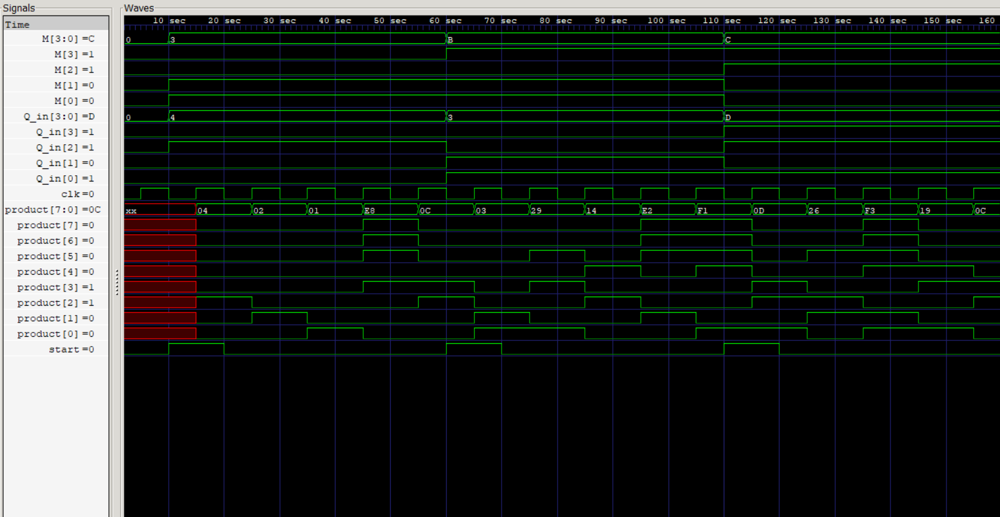

# 4-Bit Signed Booth Multiplier

A 4-bit Radix-2 Booth Multiplier designed using Verilog HDL. This project implements signed two's complement multiplication using sequential logic and verifies the functionality through a Verilog testbench and simulation waveforms.

## 1. Project Overview

The Booth Multiplier performs signed multiplication on two 4-bit two's complement inputs to produce an 8-bit signed product.

The design is implemented using sequential logic driven by a clock signal and controlled via a synchronous `start` signal, completing each multiplication in 4 clock cycles.

## 2. Features

- 4-bit signed input operands (two's complement representation)
- 8-bit signed product output
- Synchronous `start` control signal for loading and execution
- Radix-2 Booth encoding (`{Q[0], Q[-1]}`)
- Arithmetic right shift (`>>>`) preserving the sign bit
- Verilog testbench for functional verification
- Simulation waveform for output analysis

## 3. Booth Algorithm Operations

| `{Q[0], Q[-1]}` | Operation | Description |
| :--- | :--- | :--- |
| `00` | Shift Only | Arithmetic right shift of `{A, Q, Q[-1]}` by 1 bit |
| `01` | Add & Shift | `A = A + M`, followed by arithmetic right shift |
| `10` | Sub & Shift | `A = A - M`, followed by arithmetic right shift |
| `11` | Shift Only | Arithmetic right shift of `{A, Q, Q[-1]}` by 1 bit |

## 4. Input and Output Signals

| Signal | Width | Description |
| :--- | :--- | :--- |
| `clk` | 1 bit | System clock (rising-edge triggered) |
| `start` | 1 bit | High (`1`) loads inputs; Low (`0`) executes shift cycles |
| `M` | 4 bits | Signed multiplicand (`-8` to `+7`) |
| `Q_in` | 4 bits | Signed multiplier (`-8` to `+7`) |
| `product` | 8 bits | Final signed product (`{A, Q}`) |

## 5. Project Structure

```text
02-booth-multiplier/
│
├── booth_multiplier.v
│
├── booth_multiplier_tb.v
│
├── 02-booth-multiplier-waveform.png
│
└── README.md
```

## 6. Design Methodology

The multiplier uses a sequential datapath consisting of an accumulator (`A`), a multiplier shift register (`Q`), an auxiliary bit (`Q_1`), and a step counter (`count`).

When `start` is asserted, `A` and `Q_1` are cleared, `Q_in` is loaded into `Q`, and `count` is initialized to `4`.

When `start` is de-asserted, a `case` statement evaluates `{Q[0], Q_1}` on each rising clock edge to perform addition, subtraction, or no arithmetic operation before executing a signed arithmetic right shift (`>>> 1`).

## 7. Verification

The design was verified using a separate Verilog testbench.

The testbench applies positive, negative, and mixed-sign input combinations and monitors the resulting 8-bit signed product across clock cycles.

Simulation waveforms were inspected to verify the step-by-step shifting and final output of the multiplier.

### Verification Coverage

- Positive × Positive (`3 × 4 = 12`)
- Negative × Positive (`-5 × 3 = -15`)
- Negative × Negative (`-4 × -3 = 12`)
- Two's complement sign extension during arithmetic right shifts
- Load and shift state transitions via `start`

## 8. Tools Used

- Verilog HDL
- Visual Studio Code
- ModelSim / Icarus Verilog
- GTKWave
- Git and GitHub

## 9. Simulation & Waveforms

### Prerequisites
* [Icarus Verilog](http://iverilog.icarus.com/) (for compilation and simulation)
* [GTKWave](https://sourceforge.net) (for viewing `.vcd` waveform dumps)

### Running the Simulation
i. Compile the design and testbench:
   ```bash
   iverilog -o sim booth_multiplier.v booth_multiplier_tb.v
   ```
ii. Run the simulation to generate the waveform file:
   ```bash
   vvp sim
   ```
iii. Open the waveform in GTKWave:
   ```bash
   gtkwave booth_multiplier_wave.vcd
   ```

### Expected Output


## 10. Learning Outcomes

Through this project, I explored:

- Sequential circuit design using Verilog
- Two's complement signed arithmetic
- Radix-2 Booth encoding algorithm
- Signed concatenation and arithmetic right shifts (`>>>`)
- Multi-cycle testbench stimulus generation
- Simulation waveform analysis (hexadecimal and binary bit-level inspection)
- RTL debugging and verification

## 11. Future Improvements

- Parameterize the design to support N-bit operands (e.g., 8-bit, 16-bit).
- Add a `done` status flag to signal completion to external modules.
- Upgrade to a Radix-4 Booth multiplier to reduce clock cycles by half.
